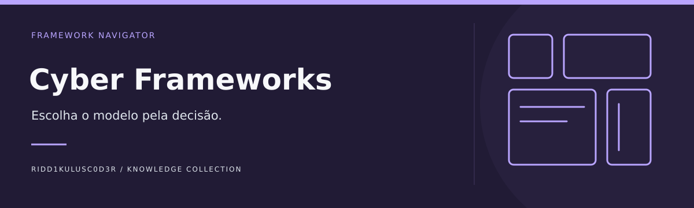

# Cyber Frameworks

**Escolha o modelo pela decisão.**

Comparar frameworks, padrões e modelos de segurança por problema, escopo, artefato de saída e limites de aplicação.

[Comece aqui](docs/COMECE-AQUI.md) · [Referências comentadas](docs/REFERENCIAS.md) · [Identidade visual](docs/IDENTIDADE-VISUAL.md) · [Caso guiado](examples/caso-01.md) · [Modelo de trabalho](templates/ficha.md)

## Objetivo e fronteiras

Catálogo transversal de decisão. RedFrameworks mantém profundidade ofensiva; Threat-Modeling reúne manuais; TCEM é metodologia própria.

## Caminhos de uso

| Etapa | Pergunta de trabalho | Entrega |
|---|---|---|
| Entender | Distinguir framework, padrão e base de conhecimento | Ficha de classificação |
| Comparar | Relacionar o modelo à pergunta | Matriz de adequação |
| Aplicar | Selecionar evidências e evitar equivalências falsas | Registro de escolha |

## Começar

1. Leia o [guia de entrada](docs/COMECE-AQUI.md).
2. Escolha uma [referência pelo problema](docs/REFERENCIAS.md), não pela popularidade.
3. Resolva o [caso sintético](examples/caso-01.md) e registre sua análise na [ficha](templates/ficha.md).

## Estado atual

Base documental inicial com objetivos, referências comentadas, modelo de trabalho e um exercício de mesa sintético. O caso é resolvido por leitura e análise; não há ambiente executável, integração ativa ou validação em produção nesta entrega.

## Contribuir

Inclua problema resolvido, fonte original, data, limitações e condições de reutilização. Diferencie observação, interpretação e hipótese. Recursos externos permanecem sujeitos às licenças e condições dos respectivos autores.

## Conexões no portfólio

[RedFrameworks](https://github.com/Ridd1kulusC0d3r/RedFrameworks) · [Threat-Modeling](https://github.com/Ridd1kulusC0d3r/Threat-Modeling) · [Cyber-Threat-Context-Modeling](https://github.com/Ridd1kulusC0d3r/Cyber-Threat-Context-Modeling)

As fronteiras acima definem a direção deste projeto; links relacionados não significam integrações implementadas.

[Matriz de escolha de frameworks](docs/MATRIZ.md)
